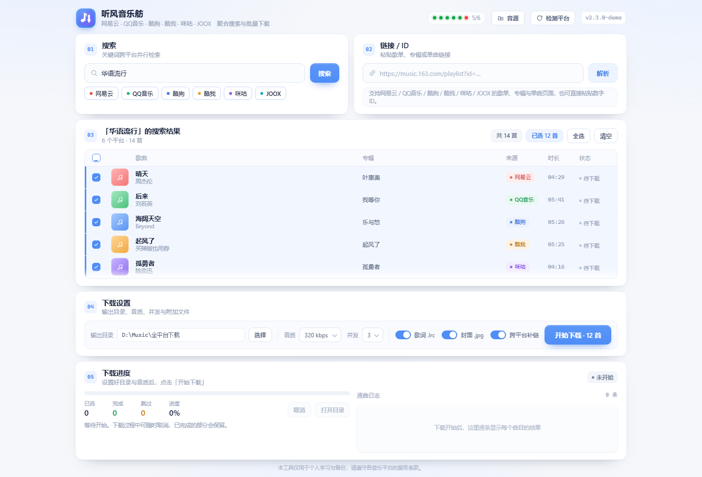
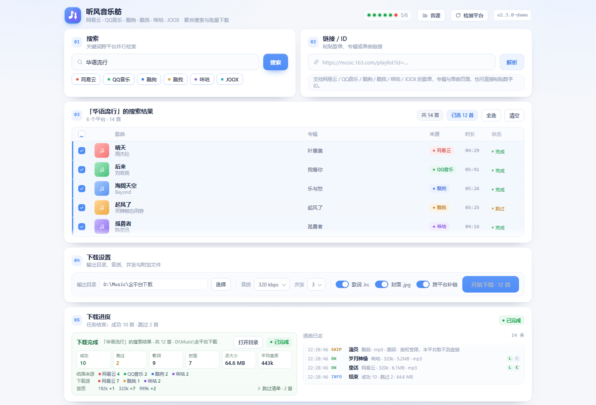

# 听风音乐舫（WindTune）

一站式搜歌 + 批量下载的 Windows 桌面工具：**网易云 / QQ音乐 / 酷狗 / 酷我 / 咪咕 / JOOX** 六平台一处搜索，
歌单、专辑、单曲链接直接粘贴解析，批量下载音频，并可选同步保存 **歌词（.lrc）** 与 **封面（.jpg）**。

支持 **无损音质**（网易云 FLAC），以及在某个平台取不到直链时 **自动跨平台补链**下载。

> 仅供个人学习与备份使用，请支持正版音乐。本工具不破解版权，只做「能公开拿到的就拿到」这件事。

> **改名沿革**：v1.0.0 叫「网易云音乐下载器」，v2.0.0 叫「全平台音乐下载器」，**v2.1.0 起定名「听风音乐舫」（WindTune）**。
> 仓库地址同步改为 `dkvkvk/windtune`（旧地址会自动跳转），安装包改名 `WindTune-Setup-<version>.exe`，`appId` 改为 `com.dkvkvk.windtune`。

## 截图

浅色主题，左侧搜索 / 右侧链接解析，下方可勾选结果批量下载：



下载完成后：六格汇总（成功 / 跳过 / 歌词 / 封面 / 大小 / 平均音质）+ 结果来源与**实际下载源**
分列显示（补链发生时两者不同）+ 右侧逐曲日志（`源 QQ音乐 → 补链网易云`，行尾 `L` `C` 标记歌词/封面是否落盘）：



## 能力矩阵

这是实测结果（2026-11），不是照抄文档——列出来的都验证过能真的拿到音频。

| 平台 | 搜索 | 歌单 | 专辑 | 下载直链 | 歌词 | 封面 |
|---|:--:|:--:|:--:|:--:|:--:|:--:|
| 网易云 | ✅ | ✅ | — | ✅ 128/192/320/**FLAC** | ✅ | ✅ |
| 酷我 | ✅ | △ | — | ✅ 128k/320k/**FLAC** | ✅ | ✅（跨平台补） |
| QQ音乐 | ✅ | ✅ | ✅ | ✖（需登录，走补链） | ✅ | 走补链 |
| 酷狗 | ✅ | ✅ | — | ✖（需签名，走补链） | ✅ | ✅ |
| JOOX | ✅ | — | — | ✖ | ✅ | ✅ |
| 咪咕 | △ 尽力而为 | — | — | ✖ | — | — |

读法：

- **✅ 下载直链** 表示能直接拿到可播放的音频文件。
- **✖ + 走补链** 表示该平台官方接口需要登录态或签名，本工具**不伪造登录**；
  它会拿「歌名 + 歌手」去网易云 / 酷我找同一首歌再下载，实测命中率很高（热门歌基本 100%）。
- 有跨平台补链，所以 **QQ / 酷狗 / 咪咕 的歌单和专辑照样能整张下下来**（搜它们的库，用网易云/酷我的音频）。
- 补链**只认同名 + 同歌手 + 版本不冲突**的曲目。下不到就如实跳过，不会拿别人的翻唱或伴奏冒充原唱
  （旧版会，那是 bug）。跳过清单里会写明原因。
- 平台接口会变，也可能被你的网络环境挡住。界面右上角「检测平台」会逐个探活，不可用的平台会标红。

## 功能

- **六平台一次搜**：并发查询，结果按平台徽章区分，可勾选任意组合批量下载
- **链接 / ID 直贴**：网易云歌单·单曲、QQ 歌单·专辑·单曲、酷狗歌单、酷我歌单·单曲；也可以直接贴纯数字 ID
- **音质**：128 / 192 / 320 kbps / **无损（FLAC）**，取不到自动降档（例如 999→320→192→128）
- **歌词 + 封面**：可选，随音频同名保存；平台自己没有就跨平台找
- **跨平台补链**（默认开启）：QQ/酷狗的歌也能下
- **并发下载** 1–8 路，实时逐曲日志（OK / SKIP 着色），可随时取消，已完成的部分保留
- **失败不静默**：跳过的歌逐条记录原因，结束时写出 `_下载报告.json` 与 `_跳过清单.txt`
- 文件名自动清洗 Windows 非法字符，重名自动加序号
- 浅色界面、原生无边框控件、contextIsolation 安全 IPC

## 下载 / 构建

安装包由 GitHub Actions 云端构建（`.github/workflows/build.yml`）：

- 构建相关改动提交到 `main` 或向 `main` 提交 PR 时触发，也可通过 `v*` tag 或手动触发
- `windows-2025` + Node.js 24 → `npm ci` → 离线集成检查 → `npm run dist`（`electron-builder --win nsis`）
- 校验 sha256、上传 artifact；`v*` tag 自动发 Release

产物：`out-electron/WindTune-Setup-<version>.exe`

> Windows 本地打包时，请将仓库检出到纯英文路径（如 `C:\src\windtune`）。NSIS 在含中文的路径中可能无法创建临时文件。

## 本地开发

使用 Node.js 24 LTS。

```bash
npm ci
npm start          # 运行（需本地 Electron 可用）
node test/e2e.js   # 只测引擎（搜索 / 歌单 / 真下载），不需要 Electron
node tools/make-icon.js   # 重新生成图标（零依赖，纯 Node）
npm run dist       # 打包 NSIS 安装包到 out-electron/
```

引擎自测会真的联网下载几首歌到系统临时目录，用来验证直链、歌词、封面、补链是否正常。

## 项目结构

```
main.js              主进程：浅色窗口 / 单实例 / IPC
preload.js           安全桥（window.api）
downloader.js        1.x 兼容层（parsePlaylist / downloadPlaylist 老接口仍可用）
src/http.js          统一请求：超时、重试、UA、取消信号、格式嗅探
src/sources.js       六平台适配器（搜索 / 直链 / 歌词 / 封面 / 歌单 / 专辑）
src/engine.js        聚合引擎：跨平台搜索、链接解析、直链瀑布、批量下载
ui/index.html        界面结构
ui/app.js            界面逻辑（无 window.api 时自动走 demo 数据，双击即可预览）
ui/style.css         浅色主题样式
assets/logo.svg      矢量图标（界面用）
assets/icon.ico      Windows 多尺寸图标（打包用，16~256）
assets/icon.png      1024×1024 主图
tools/make-icon.js   零依赖图标生成脚本（超采样光栅化 + PNG/ICO 编码）
test/e2e.js          引擎端到端自测
```

## 接口来源

**没有一个接口是官方开放平台给你的**——都是各家网页版自己在用的公开接口。这决定了它们的寿命，
所以我把所有地址集中在 [`src/endpoints.js`](src/endpoints.js)，随时可改、可替换。

| 平台 | 数据从哪来 | 能不能直接下音频 |
|---|---|---|
| **网易云** | `music.163.com` 官方接口（搜索/直链/歌词/封面/歌单） | ✅ **能，且免登录**，320k / 192k / 128k 多档 |
| **酷我** | 搜索走 `search.kuwo.cn`；音频走**波点音乐**（酷我旗下免费 App）的 `bd-api.kuwo.cn` | ✅ 能，免登录，**320k mp3 与 FLAC**（实测 FLAC 26MB） |
| **QQ 音乐** | 搜索/歌单/专辑/歌词走 `u.y.qq.com` 的 `musicu.fcg`（`c.y.qq.com` 的 `client_search_cp` 已 500 下线） | ❌ 要登录态，否则只给 **60 秒试听** |
| **酷狗** | 搜索 `songsearch.kugou.com` / 取流 `trackercdn.kugou.com`（逐档 sq/320/128 hash 试） | ⚠️ **免费曲目能下**，付费曲目 `status:2` 要登录态 |
| **JOOX** | 搜索/封面走 `cache.api.joox.com` 官方；歌词/歌单仍走 GD 音乐台 | ❌ 官方取流接口已 404 下线，只做搜索/歌词/封面 |
| **咪咕** | `app.c.nf.migu.cn` | ❌ 地区/风控限制，多数时候拿不到 |

### QQ / 酷狗 为什么下不了

这不是「没做好」，是平台把音频接口锁在登录态后面了。实测证据：

- **QQ**：歌曲详情显示 `pay_play=1`；vkey 接口对**所有正片音质**（M800/C600/F000…）返回 `errtype=104003`；
  唯一能拿到 purl 的是 `RS01`/`RS02` 前缀，而它是**60 秒试听**（两首不同的歌返回等长文件、md5 不同）。
  所以本程序**主动拒绝**这类试听地址，绝不拿它冒充整首。
- **酷狗**：`m.kugou.com` 的 `getSongInfo` 接口是活的，但对热门曲目一律返回「需要付费」/`privilege=10`。
- 业界标杆 [Listen1](https://github.com/listen1/listen1_chrome_extension) 的源码里，同样是
  `if (purl === '') { /* vip */ failure() }`——**它也没辙**，只能靠用户自己的登录 cookie。

所以本程序对这两个平台的做法是：**照常搜索/解析/拿歌词，音频走「跨平台补链」**
（从网易云或酷我找同名同歌手的音频来下载）。这也是
[洛雪音乐](https://github.com/lyswhut/lx-music-desktop) 的思路：项目协议第 1.2 条写明
「本项目本身没有获取某个音频数据的能力」，音频 URL 全部来自用户导入的「自定义源」。

### 2026-11-13 修掉的几个真问题

这些都是实测定位的，不是猜的：

1. **QQ 搜索只回 1~4 条**：之前接的是 `smartbox_new.fcg`——那是**输入框联想**接口，不是搜索。
   「晴天 周杰伦」只回 1 条、「周杰伦」回 4 条，用户看到的就是「搜不到歌」。
   现改用 `musicu.fcg` 的 `DoSearchForQQMusicDesktop`，稳定 10 条并带专辑名与时长。
   ⚠️ 该接口有**按次数限流**（`code=2001`，约 4~5 次后触发），所以加了 2.5 秒节流、
   10 分钟结果缓存、退避重试，最后才降级到联想接口。
2. **粘贴歌单链接提示「请输入关键词或链接」**：QQ 手机分享的
   `i.y.qq.com/n2/m/share/details/taoge.html?id=`、酷狗手机分享的
   `m.kugou.com/share/zlist.html?listid=` 之前认不出来。现已支持（另外修了网易云单曲链接被误判成歌单）。
3. **补链下回来的是别人的翻唱**：旧逻辑「第一个匹配上的平台定生死」，网易云搜到
   「发如雪(钢琴版)」就拿它当结果，取回来还是被截断的试听。现在按平台逐个、按候选逐个验证，
   只接受同名 + 同歌手 + 版本一致的曲目。
4. **网易云搜索会 405**：`/api/search/get/web` 有频控（`code=405 操作频繁`）。
   现在两个搜索接口取**并集**（`/web` + `/api/search/get`），后者排序更接近原版
   （「起风了」它给的才是买辣椒也用券原唱），并加了 5 分钟缓存。
5. **酷狗取流**：`trackercdn` 不封接口，只按版权标付费——免费曲目任何一档 hash 都给真地址，
   所以现在从无损往 128k 逐档试，并用 `mobilecdn` 补齐全曲目的 320/sq hash。

## 自定义音源（能用洛雪音乐的源）

这是本项目对付「QQ/酷狗 下不了」和「接口老变」的答案：**把取音频地址这件事交给可替换的脚本**。

格式与[洛雪音乐](https://github.com/lyswhut/lx-music-desktop)的自定义源**完全一致**，
社区现成的洛雪音源可以直接加载：

1. 点软件右上角「**音源**」按钮 → 打开 `%APPDATA%\windtune\sources\`
2. 把 `.js` 音源文件丢进去
3. 重启软件，右上角变成「音源 1」，日志里出现 `[音源] ✓ 名字`
4. QQ / 酷狗 的歌现在会先问音源要地址

优先级：**本平台官方接口 → 自定义音源 → 跨平台补链**。
所以不装音源也能用（网易云、酷我官方直连），装了则多出一层能力。

写音源的完整说明、字段表、模板和安全提示在 [`sources/README.md`](sources/README.md)，
`demo-netease.js` 是可以直接跑的示例，`sources/examples/` 里有 QQ/酷狗 的填空模板。

```bash
npm run check-api     # 会顺带把音源加载一遍，打印每个脚本的失败原因
```

> ⚠️ 音源脚本是任意 JavaScript，拥有与本程序相同的权限。只放你信任的脚本。
> 这是该机制固有的代价，洛雪音乐同样如此。

## 接口挂了怎么修

```bash
npm run check-api        # 一条命令测完 17 条接口，告诉你哪条死了、死在哪一步
```

输出会直接指出该改哪个常量，例如：

```
  ✗ 失效  网易云搜索              This operation was aborted
      → 改 src/endpoints.js 里的 neteaseSearch
        当前值：https://music.163.com/api/search/get/web
```

修复流程：

1. 浏览器 F12 打开对应平台网页版，找到它实际请求的地址；
2. 只改 [`src/endpoints.js`](src/endpoints.js) 里那一行（改完立刻生效，不用碰适配器代码）；
3. 再跑 `npm run check-api` 确认变绿；
4. 如果地址没变却仍失效（参数/签名/风控变了），才需要动
   [`src/sources.js`](src/sources.js) 里对应的函数——每个函数上方都注明了它调哪条接口。

**判断影响面**：`check-api` 结论行会写「两条下载链路都正常 / 仅 X 可下载 / 全失效」，
只要网易云和酷我里还有一条活着，软件就仍然能下歌。

## 版本与改名沿革

| 版本 | 显示名 | 安装包 | appId |
|---|---|---|---|
| v1.0.0 | 网易云音乐下载器 | `NeteaseMusicDownloader-Setup-1.0.0.exe` | `com.dkvkvk.netease-music-downloader` |
| v2.0.0 | 全平台音乐下载器 | `AllMusicDownloader-Setup-2.0.0.exe` | `com.dkvkvk.all-music-downloader` |
| **v2.1.0** | **听风音乐舫** | `WindTune-Setup-2.1.0.exe` | `com.dkvkvk.windtune` |

`appId` 变了意味着 Windows 会把 v2.1.0 当成**另一个软件**：旧的「全平台音乐下载器」不会自动升级，
需要手动卸载一次，之后就能正常覆盖升级。`downloader.js` 的 1.x 老接口一直保留兼容。

## License

MIT © dkvkvk
